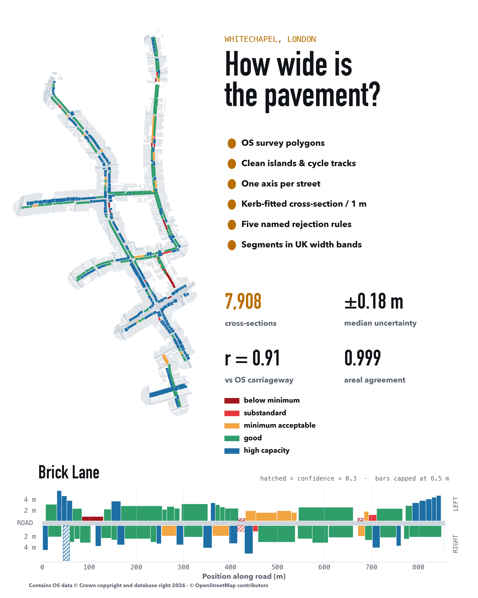
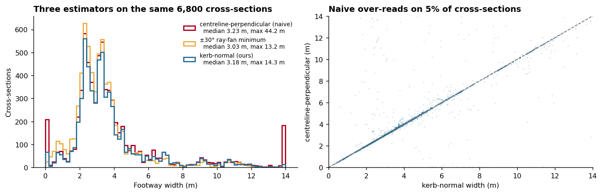
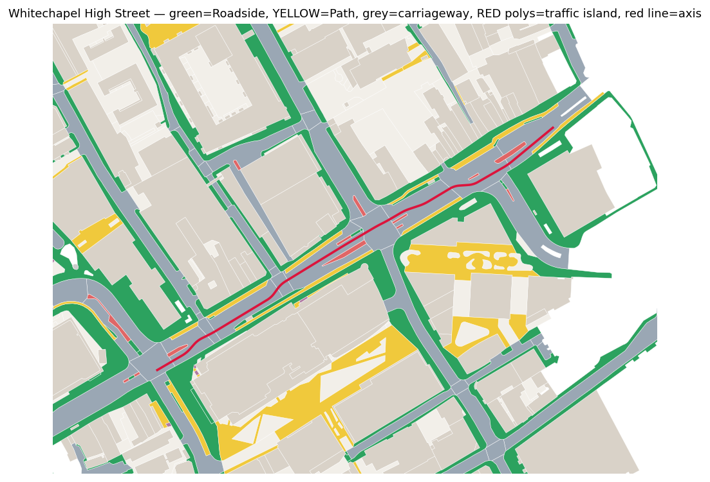
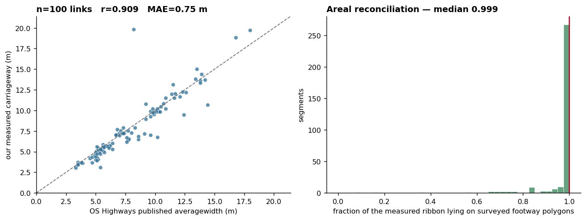
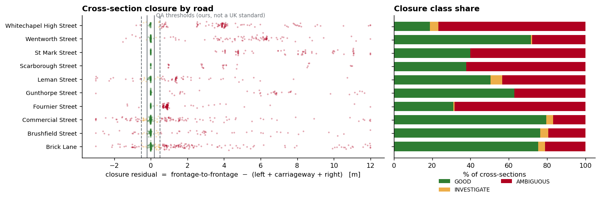
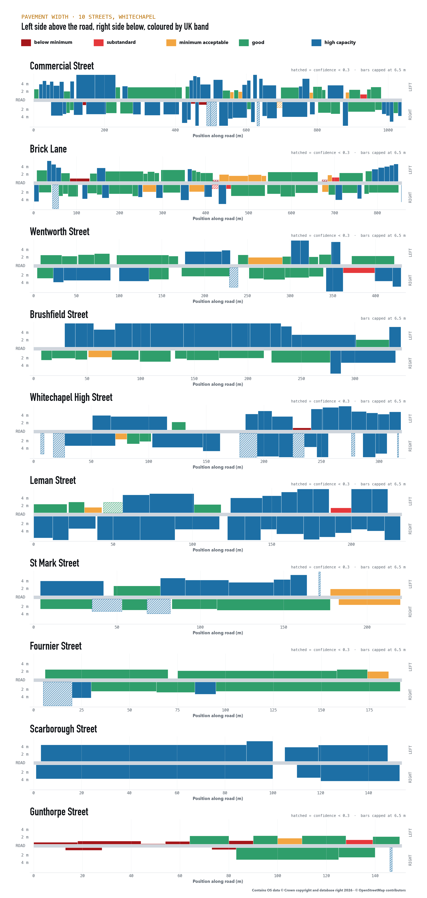

# How wide is that pavement?

**Measuring left footway, carriageway and right footway on the same cross-section, from surveyed geometry, for 10 streets in Whitechapel, East London. And knowing which numbers to trust.**


<p align="center">
  
</p>

---

## The problem

No UK dataset tells you how wide a pavement is. That's true for the left side, the right side and the road between them.

That width decides whether a wheelchair, a pushchair or two people side by side can get down a street. Planners and councils make decisions on it every day.

This project measures all three on **one shared cross-section, every metre**, for 10 streets in Whitechapel and Spitalfields. It reports total street width as `left footway + carriageway + right footway`, splits each side into segments wherever the width meaningfully changes and classifies each segment against UK footway width guidance.

Taking the measurements turned out to be the easy part. Most of the work went into deciding which numbers could be trusted.

## Headline results

<!-- AUTO:headline -->
| | |
|---|---|
| Roads measured | **10** (7 required + 3 chosen) |
| Street length | **3,946 m** |
| Cross-sections measured | **7,908**, one per metre per side |
| Retained after QA | **86.5%** — every rejection carries a named reason |
| Segments | **321**, from change-point detection, not averaging |
| Median segment uncertainty | **±0.18 m** (1σ) |
| Agreement with OS's own carriageway width | **median -0.19 m, MAE 0.75 m, r = 0.909** (100 links) |
| Areal reconciliation | **median 0.999** of the measured ribbon lies on surveyed footway polygons |
| Sensitivity | **≤0.10 m** change in median width across 12 parameter settings |
<!-- /AUTO:headline -->

**The finding that matters most:** on Gunthorpe Street, 58% of the measured pavement is narrower than 1.5 m, which UK guidance treats as below minimum acceptable. Along 41% of one side there is no pavement at all. No other road in the study goes above 7%.

---

## Why the obvious method fails

The obvious method fires a ray straight out from the road centreline and measures the pavement polygon it crosses. That works on a straight street. At a junction, though, the ray runs down the side street and counts the whole side street as pavement. This is how one pavement came out as **44 metres wide**.

| Estimator | median | 99th pct | max |
|---|---:|---:|---:|
| centreline-perpendicular (naive) | 3.23 m | **31.3 m** | **44.2 m** |
| ±30° ray-fan minimum (fallback) | 3.03 m | 11.0 m | 13.2 m |
| **kerb-normal (this project)** | 3.18 m | 11.7 m | 14.3 m |

The naive method agrees most of the time and is badly wrong on **4.7%** of cross-sections. Those failures don't move the median. They sit in the tail, which is where bad decisions get made, so they had to be engineered out because averaging can't remove them.

<p align="center"></p>

---

## Method

### Source hierarchy

```
 ┌───────────────────────────────────────────┐
 │ PRIMARY MEASUREMENT                       │  every reported width
 │ OS MasterMap Topography + Highways        │
 └─────────────────────┬─────────────────────┘
                       │
 ┌─────────────────────▼─────────────────────┐
 │ SECONDARY CORROBORATION                   │  semantics OS lacks
 │ OpenStreetMap                             │  (which `Path` strips are cycle tracks)
 └─────────────────────┬─────────────────────┘
                       │
 ┌─────────────────────▼─────────────────────┐
 │ VALIDATION ONLY                           │  adjudicates flagged segments,
 │ Satellite + Street View imagery           │  never sets a number
 └───────────────────────────────────────────┘
```

Street-level imagery and computer vision give *estimates*. Surveyed OS polygons give *measurements*. Imagery is used only to check segments the pipeline has already flagged.

### Pipeline

```
 road centreline ─► street axis (graph-diameter through-route, junction-bridged)
        │
        ▼  every 1 m
 cast a ray sideways, read the surface stack
        │
        ▼
 find the PROPERTY LINE first, then work inwards to the pavement
        │
        ▼
 re-derive the transect direction from the LOCAL KERB (weighted quadratic fit)
        │
        ▼
 robust centre of 5 overlapping transects within ±2 m
        │
        ▼
 QA: 5 named rejection rules · closure test · neighbour cross-check
        │
        ▼
 change-point segmentation ─► UK band + 95% interval + confidence + artefact risk
```

Each step addresses a specific failure:

1. **Aim at the kerb, not the middle of the road.** On a bend, a normal taken from the centreline isn't perpendicular to the kerb and overstates the width by a factor of 1/cos θ. The pipeline fits a weighted quadratic to the carriageway boundary within 4 m along the kerb and measures along that curve's normal. The fit residual tells a smooth curve (keep it) apart from a corner such as a junction radius or vehicle crossover (reject it).
2. **Find the property line first.** On Whitechapel High Street the real cross-section is `carriageway → cycle track (2.5 m) → pavement (2.6 m) → building`. A parser that assumes "carriageway, then pavement" reports 0 m there.
3. **Let OpenStreetMap fix what OS mislabels.** OS files segregated cycle tracks under `Path`, alongside alleys. Crossing OS geometry with OSM `highway=cycleway` reclassified **29 polygons**. OS has the accurate polygon with the wrong label; OSM has the right label but no usable width. Neither source could do this alone.
4. **Remove `Roadside` polygons that aren't pavement.** Traffic islands are removed geometrically (**189 polygons, 12,478 m²**, each with at least 85% of its boundary shared with the carriageway), and grass verges are removed by `make = Natural`.
5. **Reject what it can't trust, and say why.** Every rejected cross-section carries a named reason, so nothing disappears silently.

<p align="center"></p>

---

## Trying to prove it wrong

The pipeline is checked four ways, and none of the checks shares code with the measurement path:

| Check | What it tests | Result |
|---|---|---|
| **OS carriageway width** | OS Highways publishes its own `averagewidth` per link, derived independently | median −0.19 m, MAE 0.75 m, **r = 0.909** over 100 links; 79% within 1 m |
| **Cross-section closure** | Where buildings line both sides, does `left + road + right` equal frontage-to-frontage? | **median residual 0.00 m**, max 0.19 m |
| **Areal reconciliation** | Sweep 1-D widths into a 2-D ribbon; does it land on surveyed footway polygons? | **median coverage 0.999**, 88% of segments > 0.95 |
| **Parameter sensitivity** | 12 settings: transect spacing, kerb-fit radius, tolerance… | median width moves **≤ 0.10 m** |

<p align="center">
  
  
</p>

The method also reports what it doesn't know. **13.5%** of cross-sections were rejected, each with a reason. Every segment carries a 95% interval, a confidence score and an artefact risk. **45%** of band classifications are reported as *too close to call at 95%*, because a 1.51 ± 0.08 m footway can't be confidently called "minimum acceptable".

When asked to nominate the segments most likely to be wrong, the pipeline picked five that weren't on the five-widest list at all. Imagery confirmed that three were artefacts and two were unusable.

---

## Results

### Strip maps: left side above the road, right side below, coloured by UK band

<p align="center"></p>

| Band | Width |
|---|---|
| 🟫 below minimum | < 1.0 m |
| 🟥 substandard | 1.0 – 1.5 m |
| 🟧 minimum acceptable | 1.5 – 2.0 m |
| 🟩 good | 2.0 – 3.3 m |
| 🟦 high capacity | > 3.3 m |

Individual strip maps are in [`outputs/figures/`](outputs/figures/).

### Per road

<!-- AUTO:results -->
| Road | Segments | Measured | Median footway | ±1σ | Median carriageway | % <1.5 m | % ≥2.0 m | QA retained | Confidence |
|---|---:|---:|---:|---:|---:|---:|---:|---:|---:|
| Leman Street *(chosen)* | 32 | 439 m | 5.07 m | 0.33 | 7.77 m | 3.0 | 94.5 | 89.9% | 0.71 |
| Whitechapel High Street | 32 | 461 m | 5.00 m | 0.22 | 20.03 m | 3.5 | 94.4 | 70.2% | 0.66 |
| Scarborough Street | 7 | 282 m | 4.44 m | 0.16 | 4.72 m | 0.0 | 100.0 | 86.6% | 0.80 |
| Brushfield Street | 26 | 632 m | 4.08 m | 0.16 | 7.75 m | 0.0 | 96.5 | 88.7% | 0.84 |
| Commercial Street | 81 | 1,815 m | 3.52 m | 0.18 | 10.62 m | 3.5 | 93.4 | 85.3% | 0.73 |
| St Mark Street | 16 | 407 m | 3.49 m | 0.16 | 5.31 m | 0.0 | 80.6 | 85.8% | 0.84 |
| Wentworth Street *(chosen)* | 32 | 759 m | 2.91 m | 0.16 | 7.15 m | 4.9 | 89.9 | 86.6% | 0.81 |
| Brick Lane | 67 | 1,620 m | 2.68 m | 0.17 | 5.48 m | 7.2 | 80.4 | 89.2% | 0.82 |
| Fournier Street *(chosen)* | 10 | 360 m | 2.57 m | 0.17 | 5.09 m | 0.0 | 96.9 | 91.9% | 0.83 |
| Gunthorpe Street | 18 | 291 m | 1.11 m | 0.17 | 3.51 m | 57.7 | 38.8 | 96.7% | 0.82 |
<!-- /AUTO:results -->

Three of the roads were chosen to stress-test the method:

- **Leman Street:** a wide A-road with a segregated cycle track. It tests whether cycle infrastructure gets absorbed into the footway.
- **Wentworth Street:** the Petticoat Lane market, partly pedestrianised. Carriageway and footway genuinely blur here.
- **Fournier Street:** an intact Georgian terrace whose width is essentially constant, used as a *control*. Any variation reported there is measurement error. It measured σ 0.17 m, 97% of its length in the "good" band and nothing below 1.5 m.

### Total street width, on the same cross-section (metres)

<!-- AUTO:cross_section -->
| Road | Left footway | Carriageway | Right footway | **Total street width** | Frontage to frontage | Median strip |
|---|---:|---:|---:|---:|---:|---|
| Whitechapel High Street | 3.85 | 20.03 | 3.95 | **30.29** | 28.22 | 2.84 m on 19% |
| Commercial Street | 3.33 | 10.62 | 3.39 | **19.65** | 19.89 | 1.36 m on 4% |
| Leman Street | 4.66 | 7.77 | 5.48 | **19.28** | 19.66 | — |
| Brushfield Street | 8.71 | 7.75 | 2.70 | **18.61** | 18.67 | — |
| Scarborough Street | 4.46 | 4.72 | 3.82 | **13.04** | 16.56 | — |
| Wentworth Street | 2.49 | 7.15 | 3.18 | **12.98** | 13.23 | — |
| St Mark Street | 3.84 | 5.31 | 2.89 | **12.31** | 16.40 | — |
| Brick Lane | 2.53 | 5.48 | 2.43 | **10.53** | 10.72 | — |
| Fournier Street | 2.25 | 5.09 | 2.60 | **9.75** | 10.22 | — |
| Gunthorpe Street | 1.01 | 3.51 | 0.74 | **5.75** | 9.36 | — |
<!-- /AUTO:cross_section -->

*"Left" and "right" are relative to a deterministic axis: south-to-north for streets that run mostly north–south, west-to-east otherwise. The labels stay consistent along a street's full length, even where it bends.*

### The five widest segments: genuine or artefact?

Each one was checked against satellite imagery and Street View.

<!-- AUTO:widest -->
| # | Road | Side | Position | Width | σ | Confidence | Risk | Verdict |
|---|---|---|---|---:|---:|---:|---:|---|
| 1 | Commercial Street | right | 488–498 m | **14.13 m** | 1.51 | 0.22 | 0.61 | **MIXED — real paving, wrong thing** |
| 2 | Leman Street | left | 213–222 m | **12.28 m** | 0.27 | 0.69 | 0.37 | **GENUINE — plaza-type** |
| 3 | Leman Street | left | 176–185 m | **12.24 m** | 0.86 | 0.43 | 0.59 | **GENUINE but unstable** |
| 4 | Leman Street | left | 200–212 m | **11.82 m** | 0.18 | 0.89 | 0.32 | **GENUINE — plaza-type** |
| 5 | Brushfield Street | left | 39–55 m | **11.52 m** | 0.19 | 0.87 | 0.33 | **GENUINE** |
<!-- /AUTO:widest -->

Four of the five are genuine wide pavement. The fifth is Christ Church Spitalfields' forecourt: real, walkable paving, but not linear footway. The pipeline had already flagged it (confidence 0.22). Full verdicts and evidence are in [`verification_verdicts.csv`](outputs/tables/verification_verdicts.csv).

### The five the method itself flags as riskiest

<!-- AUTO:risky -->
| Road | Side | Position | Width | σ | Confidence | Risk | Verdict |
|---|---|---|---:|---:|---:|---:|---|
| Commercial Street | right | 499–515 m | 10.74 m | 1.52 | 0.19 | 0.72 | **MIXED** |
| Whitechapel High Street | right | 179–193 m | 10.06 m | 1.58 | 0.25 | 0.67 | **ARTEFACT — junction splay** |
| Whitechapel High Street | right | 17–26 m | 8.14 m | 3.14 | 0.30 | 0.66 | **ARTEFACT** |
| Leman Street | right | 221–230 m | 10.16 m | 1.40 | 0.35 | 0.65 | **MIXED** |
| Fournier Street | right | 5–19 m | 7.04 m | 1.59 | 0.29 | 0.65 | **ARTEFACT — forecourt at a junction mouth** |
<!-- /AUTO:risky -->

All five were flagged before any imagery was checked.

---

## Where it isn't solid

| Failure mode | Effect | How it surfaces |
|---|---|---|
| Junction mouths | Ray escapes into a side street | `ray_reentered_road`, `junction_mouth`, `carriageway_leak` — rejected |
| Shared space & precincts | `Roadside`/`Path` stop meaning "pavement" | `footway_from_path`, `opens_onto_pedestrian_area` |
| Large paved forecourts | Walkable, but not linear footway | back edge `general` not `building`; closure AMBIGUOUS |
| **Parking laybys** | Behind the kerb, tagged `Roadside`, not walkable | **Main residual weakness**, caught only where OS drew a separate polygon |
| Corner splays | Real pavement, but the width is the corner radius | low confidence, high artefact risk |
| Dual carriageways | Kerb-to-kerb legitimately spans the median | median strip reported separately |
| Data edge | Polygons clipped at the extent | back edge `void`, confidence reduced |

Fixing laybys is the next step: OSM `parking:lane` tagging here is too sparse to fill the gap.

**Three things about the source data worth knowing:**

1. OS `Roadside` doesn't mean "pavement". It also covers islands, verges and laybys.
2. OS MasterMap Highways (Paths) has **no pavement links**: all 2,259 are `Path`, `Path With Steps`, `Subway` or `Footbridge`.
3. Segregated cycle tracks are filed under `Path`, alongside alleys.

---

## Beyond the 10 streets

- **Borough scale:** the same pipeline ran unattended over **84 streets (28.5 km, 1,290 segments)** in Tower Hamlets and was joined to LSOA 2021 boundaries. It finished in 75 s with zero failures, which shows the method generalises rather than being hand-tuned to the 10 streets.
- **Effective walkable width:** an optional accessibility measure that takes street furniture (from OSM and OS) away from the geometric width. It's reported alongside the geometric width and never replaces it. The useful number is the pinch point: a 2.4 m footway that narrows to 1.6 m at every cycle stand is a 1.6 m footway for a wheelchair user.

---

## Repository

```
src/sidewalk/          the library
  config.py            parameters, UK bands, QA thresholds (all swept in sensitivity)
  dataio.py            loading, surface classification, island & cycle-track separation
  axis.py              street axis from the link graph
  geom.py              ray casting, surface profiles, local kerb frame
  transect.py          the measurement engine
  qa.py                neighbour cross-check, closure classification
  segment.py           change-point detection + banding
  confidence.py        uncertainty budget, confidence, artefact risk
  obstruction.py       effective walkable width
  osm.py               OSM corroboration + street furniture
  validate.py          OS width check, areal reconciliation, sensitivity
  viz.py               strip maps and diagnostics

notebooks/             sidewalk_width_assessment.ipynb — full worked analysis, pre-executed
scripts/               run_all · run_validation · run_borough · make_summary
                       make_figures · build_map · build_notebook · sync_docs
api/main.py            read-only FastAPI over the results
tests/                 unit tests on synthetic geometry + integration tests
outputs/tables/        segments, cross-sections, validation and verification CSV/JSON
outputs/figures/       strip maps + method/validation figures
```

## Running it

```bash
pip install -e ".[dev,api]"
```

You need the OS MasterMap GeoPackages in `data/` (see [Data](#data--licensing)). Then:

```bash
python scripts/run_all.py          # measure the 10 roads           ~90 s
python scripts/run_validation.py   # four independent checks        ~5 min
python scripts/make_summary.py     # total street width per road
python scripts/make_figures.py     # method + validation figures
python scripts/build_map.py        # interactive HTML map (local only)
python scripts/sync_docs.py        # refresh the tables in this README from outputs/
pytest -q
uvicorn api.main:app --reload      # http://localhost:8000/docs
```

Docker (the licensed data is mounted, never baked into the image):

```bash
docker compose --profile batch run pipeline
docker compose up api
```

The integration tests skip themselves when `data/` is absent, so CI passes on a clean clone. `outputs/tables/run_metadata.json` records the CRS and every pipeline parameter next to each run. The CRS (EPSG:27700) is asserted on load, never assumed.

---

## Data & licensing

| Source | Use | Licence |
|---|---|---|
| OS MasterMap Topography Layer, Highways Network (Roads/RAMI, Paths), Building Heights, Greenspace | Primary measurement | © Crown copyright and database rights 2026, via EDINA Digimap. **Not included in this repo.** |
| OpenStreetMap | Cycle-track semantics, street furniture | © OpenStreetMap contributors, ODbL |
| ONS LSOA 2021 boundaries | Borough aggregation | Open Government Licence |
| Google satellite / Street View | Visual verification of flagged segments only | Not redistributed |

The raw OS data, and the outputs that embed OS vector geometry (`outputs/geo/`, `outputs/map/`), are excluded under the OS licence. To reproduce, get the same products for the Whitechapel extent from [Digimap](https://digimap.edina.ac.uk/) and place them under `data/`.

*Contains OS data © Crown copyright and database right 2026 · © OpenStreetMap contributors.*
